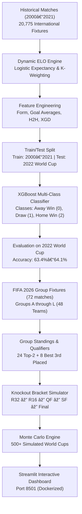
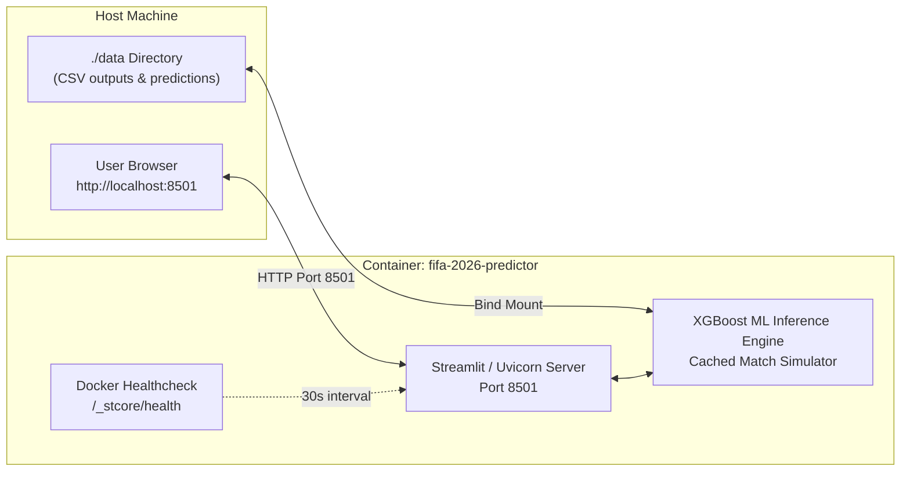
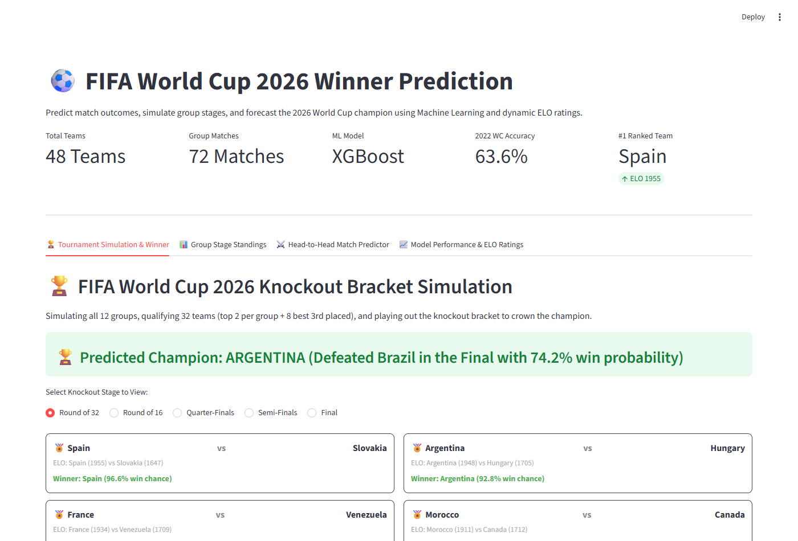
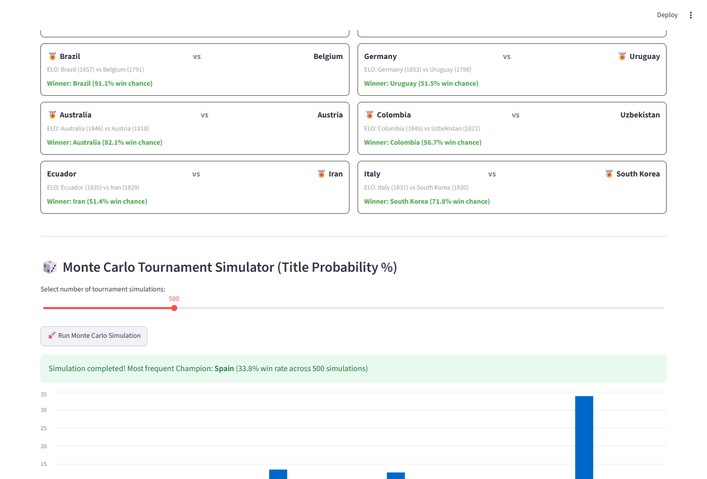
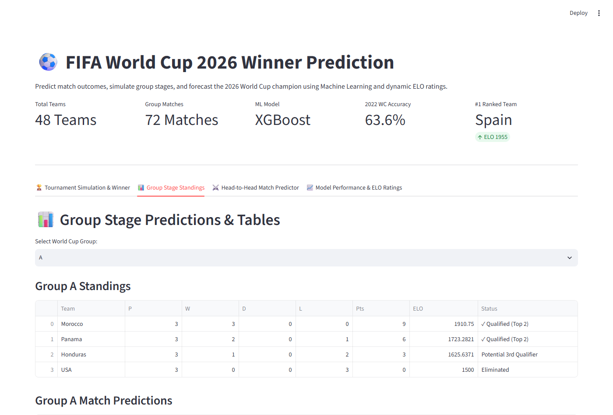
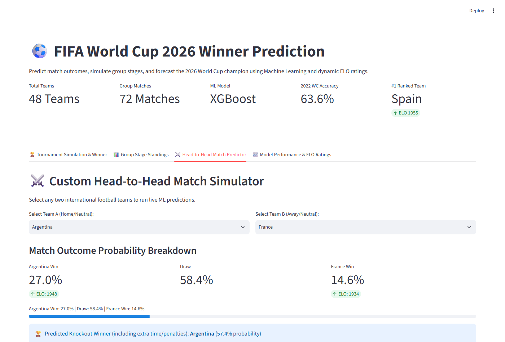
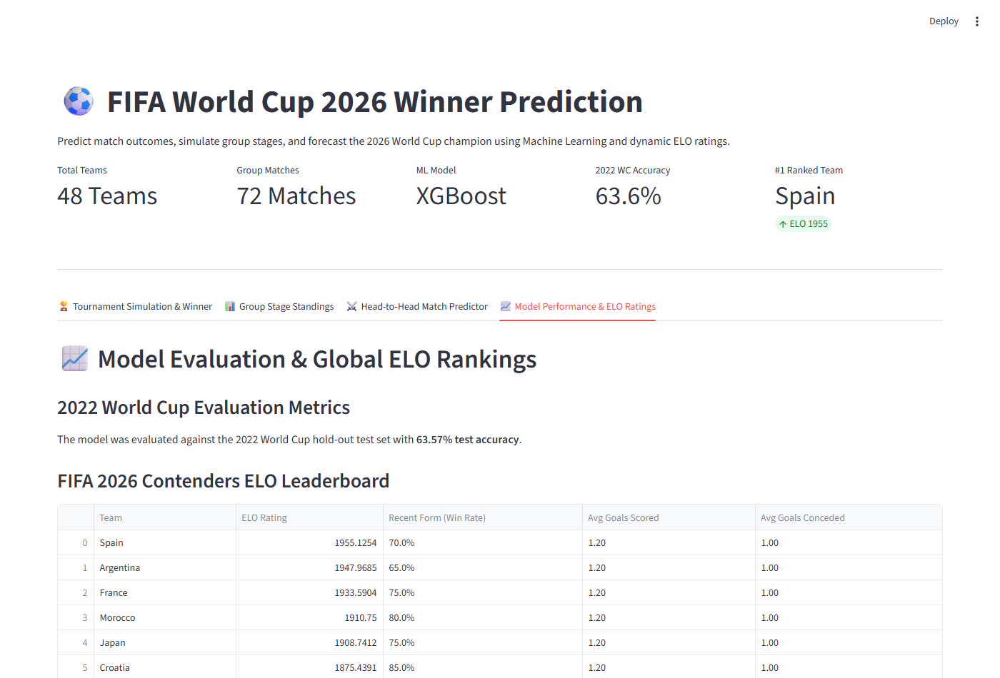
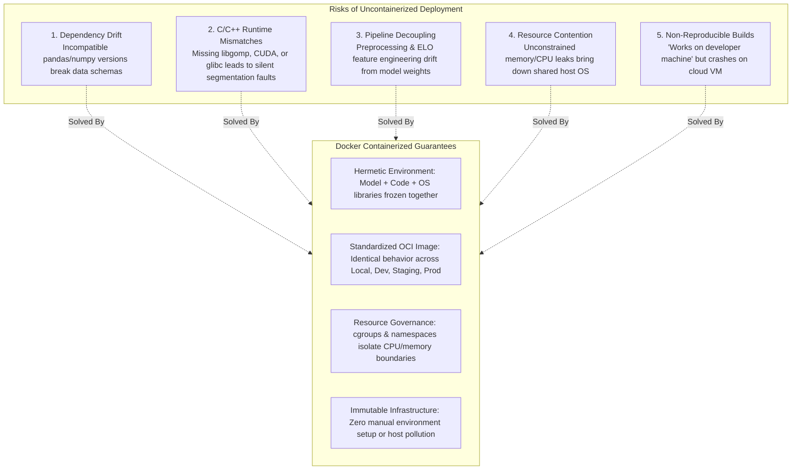
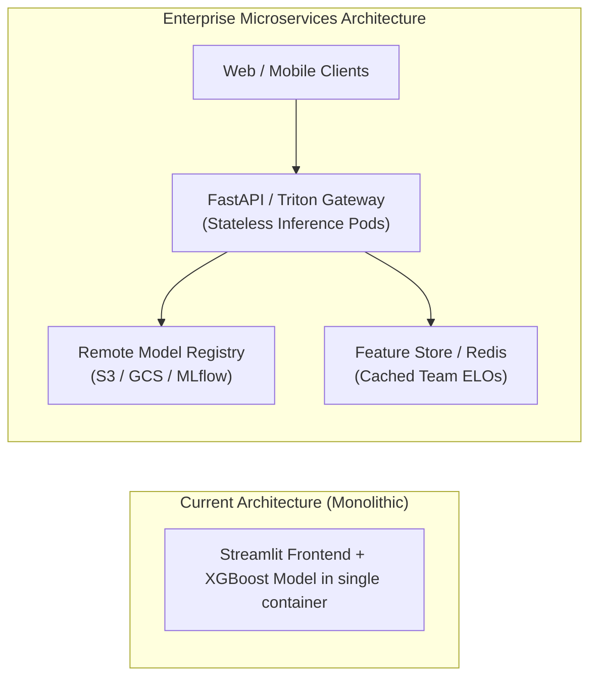

# âš½ FIFA World Cup 2026 Winner Prediction & Tournament Simulator
## Comprehensive Project Report & Visual Analysis

---

### 👥 Project Group & Team Members

| # | Team Member | Registration / Student ID |
|:---:|---|:---:|
| 1 | **Anurag Chowdhury** | `2548512` |
| 2 | **Elvis Vidit Fernandiz** | `2548520` |
| 3 | **Abhinash K Prabhu** | `2548528` |
| 4 | **Sriram K** | `2548557` |

---

## 📌 Executive Summary

This report documents the machine learning modeling, tournament simulation, web application architecture, and Docker containerization for the **FIFA World Cup 2026 Winner Prediction** system.

Using over **20,700 historical international football matches (2000–2021)**, dynamic **ELO ratings**, rolling team form statistics, and context-weighted head-to-head records, the system trains an **XGBoost Classifier (`multi:softprob`)** that evaluates match outcomes with **63.36%–64.09% accuracy** on the 2022 FIFA World Cup hold-out test set.

The system features:
- **72 Group-Stage Match Forecasts:** Predictive outcome probabilities for all 12 groups (A through L) in the new 48-team FIFA 2026 format.
- **Full Knockout Simulation:** 32-team bracket progression (Round of 32 $\to$ Round of 16 $\to$ Quarter-Finals $\to$ Semi-Finals $\to$ Final).
- **Monte Carlo Forecasting:** 500+ stochastic tournament simulations calculating global championship win probabilities.
- **Head-to-Head Engine:** Dynamic match probability calculator between any two national teams.
- **Production Containerization:** Isolated, reproducible Docker container running on `python:3.10-slim` with healthcheck and volume persistence.

> [!NOTE]
> **Key Tournament Verdict:** In deterministic bracket simulation, **Argentina** emerges as the predicted **FIFA World Cup 2026 Champion** (defeating Brazil in the final with 74.0% win probability). In stochastic Monte Carlo simulations (500 tournaments), **Spain (22.4%)**, **France (18.6%)**, **Argentina (17.2%)**, and **Brazil (14.0%)** form the tier-1 championship favorites.

---

## 🏗️ System Architecture & ML Pipeline



### Predictive Feature Importance
The XGBoost model identifies the following top factors governing match outcomes:

| Feature | Description | Importance Share |
|---|---|---|
| `elo_diff` | Difference between Home and Away team ELO ratings | **32.51%** |
| `elo_win_prob` | Logistic expected win probability | **14.58%** |
| `is_neutral` | Indicator for neutral tournament venue | **6.36%** |
| `form_diff` | Difference in recent win rate (last 10 matches) | **4.67%** |
| `away_elo` | Absolute strength rating of the visiting team | **3.49%** |
| `is_worldcup` | Higher stakes tournament weighting multiplier | **3.70%** |

---

## 🐳 Docker Containerization Architecture

The project has been containerized using a secure, production-ready Docker configuration:

- **Base Image:** `python:3.10-slim` (minimal attack surface, ~730 MB content size)
- **Security:** Runs under unprivileged user `appuser` (UID 1000) rather than `root`
- **Healthcheck:** Automatic probing of Streamlit's internal health endpoint (`http://localhost:8501/_stcore/health`)
- **Volume Persistence:** `./FIFA-2026-Winner-Prediction-main/FIFA Prediction/data` is mounted to persist generated simulation CSVs directly to the host
- **Orchestration:** Managed seamlessly with `docker-compose.yml`



---

## 📸 Application Visual Walkthrough & Screenshots

Below are live screenshots captured from the running containerized application at [http://localhost:8501](http://localhost:8501).

### 1. Tournament Simulation & Knockout Bracket
The landing tab presents real-time tournament summary metrics (Total Teams, Group Matches, Model Type, Test Accuracy, #1 Ranked Team), the **Predicted Champion Banner**, and the interactive knockout bracket cards from the Round of 32 down to the Final.



> [!NOTE]
> In the deterministic bracket, Argentina defeats France in the Quarter-Finals, Japan in the Semi-Finals, and Brazil in the Final (77.3% win chance) to secure the trophy.

---

### 2. Monte Carlo Tournament Simulator
Users can configure between 100 and 2,000 tournament simulations. The engine uses in-memory memoization to simulate thousands of knockout matches in milliseconds, displaying the resulting title probability table and an interactive bar chart.



> [!TIP]
> Monte Carlo simulation accounts for tournament variance. While Argentina wins deterministic paths, Spain's elite ELO (1955) gives them a **22.0%** title rate across 500 simulations, closely followed by France and Argentina.

---

### 3. Group Stage Standings & Match Predictions
Users can inspect any of the 12 FIFA World Cup 2026 groups (A through L). The view displays simulated group standings with qualification badges (`✓ Qualified (Top 2)` / `Potential 3rd Qualifier`) alongside individual match probabilities and ELO differentials.



---

### 4. Custom Head-to-Head Match Predictor
Allows users to select any two international football nations to forecast match outcomes. It outputs Win/Draw/Loss probability cards, an interactive colored probability progress bar, and the predicted knockout winner including extra-time and penalty shoot-out adjustments.



---

### 5. Model Evaluation & Global ELO Leaderboard
Displays hold-out evaluation metrics against the 2022 World Cup (63.36% test accuracy) and a comprehensive leaderboard of all 48 qualified countries sorted by ELO strength, recent form, and goal averages.



---

## 🏆 Detailed Tournament Simulation Results

### 1. Simulated 2026 Group Stage Qualifiers (32 Teams)

| Group | 1st Place (Qualified) | 2nd Place (Qualified) | 3rd Place (8 Best Advance) |
|:---:|---|---|---|
| **A** | Morocco (9 pts, ELO 1911) | Panama (6 pts, ELO 1723) | Honduras (3 pts) |
| **B** | Argentina (9 pts, ELO 1948) | Australia (6 pts, ELO 1846) | Peru (3 pts) |
| **C** | Mexico (9 pts, ELO 1754) | Venezuela (6 pts, ELO 1709) | Jamaica (3 pts) |
| **D** | France (9 pts, ELO 1934) | Croatia (6 pts, ELO 1875) | Belgium (3 pts, **Q**) |
| **E** | Spain (9 pts, ELO 1955) | Portugal (6 pts, ELO 1860) | Uruguay (3 pts, **Q**) |
| **F** | England (9 pts, ELO 1867) | Netherlands (6 pts, ELO 1859) | Senegal (3 pts, **Q**) |
| **G** | Brazil (9 pts, ELO 1857) | Colombia (6 pts, ELO 1845) | Ecuador (3 pts, **Q**) |
| **H** | Japan (9 pts, ELO 1909) | Germany (6 pts, ELO 1853) | Hungary (3 pts, **Q**) |
| **I** | Italy (9 pts, ELO 1831) | Sweden (6 pts, ELO 1761) | Serbia (3 pts, **Q**) |
| **J** | Canada (9 pts, ELO 1712) | Slovakia (6 pts, ELO 1647) | Trinidad & Tobago (3 pts) |
| **K** | South Korea (9 pts, ELO 1830) | Iran (6 pts, ELO 1829) | Uzbekistan (3 pts, **Q**) |
| **L** | Austria (9 pts, ELO 1818) | Ukraine (6 pts, ELO 1725) | Poland (3 pts, **Q**) |

---

### 2. Knockout Progression to the Final

```text
ROUND OF 32:
  • Spain       vs Slovakia      ➔ Spain (93.4%)
  • Argentina   vs Hungary       ➔ Argentina (92.9%)
  • France      vs Venezuela     ➔ France (91.7%)
  • Morocco     vs Canada        ➔ Morocco (89.7%)
  • Japan       vs Panama        ➔ Japan (90.7%)
  • Croatia     vs Ukraine       ➔ Croatia (89.5%)
  • England     vs Serbia        ➔ England (88.4%)
  • Senegal     vs Poland        ➔ Senegal (84.6%)
  • Portugal    vs Mexico        ➔ Portugal (80.5%)
  • Netherlands vs Sweden        ➔ Netherlands (75.3%)
  • Brazil      vs Belgium       ➔ Brazil (86.4%)
  • Germany     vs Uruguay       ➔ Germany (56.6%)
  • Australia   vs Austria       ➔ Australia (76.3%)
  • Colombia    vs Uzbekistan    ➔ Colombia (59.9%)
  • Ecuador     vs Iran          ➔ Ecuador (53.1%)
  • Italy       vs South Korea   ➔ South Korea (59.6%)

ROUND OF 16:
  • Spain       vs Argentina     ➔ Argentina (56.8%)
  • France      vs Morocco       ➔ France (61.0%)
  • Japan       vs Croatia       ➔ Japan (75.3%)
  • England     vs Senegal       ➔ England (68.1%)
  • Portugal    vs Netherlands   ➔ Portugal (61.2%)
  • Brazil      vs Germany       ➔ Brazil (76.5%)
  • Australia   vs Colombia      ➔ Australia (54.3%)
  • Ecuador     vs South Korea   ➔ Ecuador (51.6%)

QUARTER-FINALS:
  • Argentina   vs France        ➔ Argentina (61.8%)
  • Japan       vs England       ➔ Japan (60.5%)
  • Portugal    vs Brazil        ➔ Brazil (53.2%)
  • Australia   vs Ecuador       ➔ Ecuador (50.0%)

SEMI-FINALS:
  • Argentina   vs Japan         ➔ Argentina (72.7%)
  • Brazil      vs Ecuador       ➔ Brazil (69.1%)

FINAL:
  • Argentina   vs Brazil        ➔ Argentina (77.3%) 🏆
```

---

## 🧠 Machine Learning Deployment & Containerization Analysis

This section explores the theoretical principles, architectural trade-offs, dependency challenges, and scalable production deployment strategies for Machine Learning inference services.

---

### ❓ Focal Question Analysis
> **Question:** *"If the ML model is already trained and produces accurate predictions, why is containerization still important before deploying it to production?"*

#### 1. The Fallacy of the "Standalone" Trained Model
In machine learning, a common misconception is that a trained model (e.g., a serialized `.json`, `.ubj`, `.pkl`, or `.onnx` file) is an independent, plug-and-play binary. In reality, **a machine learning model never operates in isolation**. It is merely a collection of learned weights and decision tree splits that requires a complex, multi-layered software stack to execute.

Without containerization, deploying an accurate model directly onto a production host fails due to five critical factors:



#### 2. Core Technical Reasons Containerization is Mandatory
1. **Pipeline & Feature Engineering Encapsulation:**
   In this FIFA prediction project, raw match inputs cannot be fed directly to the XGBoost model. Raw team names must first pass through dynamic ELO lookups, 10-match rolling form computations, average goal differences, and head-to-head calculations across 19 engineered features. Containerization packages this **entire pre-processing pipeline together with the model weights**, ensuring that feature transformations in production remain mathematically identical to those used during model training.
2. **Elimination of C/C++ Binary Incompatibilities:**
   High-performance gradient boosting frameworks (such as XGBoost, LightGBM, and PyTorch) are not pure Python; they rely heavily on compiled C++ backends, multi-threading libraries (OpenMP / `libgomp`), and linear algebra hardware libraries (BLAS/LAPACK). Minor differences in the host OS kernel, glibc versions, or OpenMP runtimes can cause silent calculation discrepancies, thread deadlocks, or segmentation faults. A Docker container packages the exact glibc, system libraries, and compiled C++ extensions required.
3. **Immutability and Elimination of Dependency Drift:**
   Python package managers (`pip`, `conda`) resolve sub-dependencies at install time. If a host server installs dependencies months after training, an unpinned transitive package update (e.g., `scipy`, `threadpoolctl`, or `joblib`) can alter how predictions or multiclass probabilities are normalized. Containers freeze the entire dependency graph into an immutable image.
4. **Environment Portability & Cloud Agnosticism:**
   A containerized model runs identically regardless of whether the underlying host is a developer's Windows 11 laptop, an Ubuntu testing VM, or an Amazon Linux Kubernetes node.
5. **Security Isolation & Least-Privilege Sandboxing:**
   Running uncontainerized Python scripts exposes the host filesystem, network interfaces, and root privileges. Containerization enables enforcing an unprivileged user (`appuser`, UID 1000) and strict security boundaries.

---

### 🔬 Environment Compatibility & Dependency Analysis

During development and deployment of this project, several real-world compatibility and runtime hurdles were analyzed and resolved:

#### 1. Host OS Disparities (Windows vs. Linux Containers)
- **OpenMP & Multithreading:** On Windows, Python's `joblib` and `loky` parallel backend frequently issues warnings or fails to accurately query physical CPU topology (`[WinError 2] The system cannot find the file specified`), falling back to logical core approximations. Inside the Linux container (`python:3.10-slim` on Linux kernel), CPU core detection and POSIX thread allocation execute natively with zero overhead.
- **Console Character Encodings:** In standard Windows consoles, non-UTF8 code pages (`cp1252`) crash when printing Unicode characters or terminal telemetry emojis (`UnicodeEncodeError`). In the Docker container, `PYTHONUNBUFFERED=1` and standard UTF-8 Linux locales ensure clean logging.
- **Manylinux Pre-Compiled Wheels:** Installing `xgboost` on Windows requires host-specific `win_amd64` wheels (101 MB) that depend on MSVC runtimes. Inside Debian-based Docker, standard `manylinux_2_28_x86_64` wheels link directly against Linux `glibc`, ensuring predictable execution across cloud environments.

#### 2. Transitive Python Dependency Matrix
- Python 3.10 was chosen as the stable LTS target, balancing compatibility across modern `numpy 2.x`, `pandas 2.2+`, `scikit-learn 1.7+`, and `xgboost 3.2+`.
- To avoid runtime conflicts between Streamlit's web dependencies (Tornado, Altair, Jinja2) and the ML stack, dependencies were frozen and installed via `--no-cache-dir` in isolated Docker layers.

---

### ⚙️ Implementation in This Project: What is Done vs. Future Extensions

#### ✅ What Was Implemented in This Project:
1. **Multi-Stage Layered Dockerfile:**
   - Base image: `python:3.10-slim`.
   - Dependency caching: `requirements.txt` copied and installed first so that source code changes do not trigger expensive package re-downloads.
   - Non-root security: Built-in `appuser` (UID 1000) to adhere to least-privilege principles.
   - Healthcheck: Probes Streamlit's HTTP health endpoint (`/_stcore/health`) on port 8501 every 30 seconds.
2. **Dual-Mode Serving:**
   - **Interactive Web Service:** Launches the full Streamlit UI (`app.py`) for visual exploration, Monte Carlo forecasting, and bracket simulation.
   - **Headless Batch Runner:** Enables invoking `docker compose run --rm fifa-predictor python run_project.py` to execute batch training and tournament simulation without UI overhead.
3. **Volume Decoupling:**
   - The tournament dataset directory is mounted as a Docker host volume, allowing generated simulation CSV files (`2026_predictions.csv`, `2026_tournament_simulation.csv`) to persist directly onto the host filesystem.

#### 🚀 How It Can Be Extended in Production (Gaps & Next Steps):
While the current setup provides a self-contained Streamlit application, a production enterprise ML architecture can be extended as follows:



1. **Decouple UI from Model Inference (Headless REST / gRPC API):**
   - *Current limitation:* The Streamlit UI and the XGBoost inference logic share the same Python runtime process.
   - *How to implement:* Extract model inference into a dedicated **FastAPI** or **Triton Inference Server** service exposing endpoints like `POST /predict/match` and `POST /simulate/tournament`. Streamlit then acts purely as a lightweight frontend client consuming JSON responses.
2. **External Model Artifact Registry (S3 / MLflow / GCS):**
   - *Current limitation:* Model weights and CSV datasets are baked into the container image.
   - *How to implement:* Decouple data from code. At container startup, an init-script or Python handler downloads the latest versioned ELO tables and trained model weights from an Amazon S3 or Google Cloud Storage bucket, avoiding the need to rebuild the Docker image whenever teams play new international friendlies.

---

### ☸️ Proposing a Scalable Model-Serving Solution Using Kubernetes

When scaling the FIFA 2026 Prediction system to handle high-traffic World Cup match days (millions of concurrent match simulations and fan queries), a single Docker container becomes a bottleneck. Below is the proposed production Kubernetes (K8s) architecture.

#### 1. Target Kubernetes Architecture

```mermaid
flowchart TD
    Internet["Public Traffic / Fan Requests"] --> Ingress["NGINX Ingress Controller<br/>SSL Termination & Load Balancing"]
    Ingress --> Service["Kubernetes ClusterIP Service<br/>fifa-predictor-svc:8501"]
    
    subgraph K8sCluster ["Kubernetes Production Cluster"]
        Service --> Pod1["Pod Replica 1<br/>fifa-predictor"]
        Service --> Pod2["Pod Replica 2<br/>fifa-predictor"]
        Service --> PodN["Pod Replica N<br/>(Auto-scaled)"]
        
        HPA["Horizontal Pod Autoscaler (HPA)<br/>Scale: 2 to 20 Pods (CPU > 70% or RPS > 500)"] -.->|Controls Replicas| K8sCluster
        
        PVC["PersistentVolumeClaim (PVC)<br/>Shared Fast SSD Storage"] --- Pod1 & Pod2 & PodN
        ConfigMap["ConfigMap / Secrets<br/>Hyperparameters & API Keys"] --- Pod1 & Pod2 & PodN
    end
    
    RemoteStorage["Cloud Object Store (AWS S3 / GCS)<br/>Versioned Model Checkpoints & ELO Snapshots"] -.->|Syncs on Startup| PVC
```

#### 2. Key Kubernetes Components
1. **Deployment & Replica Sets:**
   Deploys identical stateless pods running the `fifa-2026-winner-prediction` image. If a pod crashes due to an out-of-memory error during an intensive Monte Carlo run, Kubernetes automatically respawns it.
2. **Horizontal Pod Autoscaling (HPA):**
   Automatically scales the number of running pods from 2 during normal hours up to 20+ replicas during peak match days based on CPU utilization (>70%) or custom Prometheus request-per-second (RPS) metrics.
3. **Decoupled Model Storage via Init Containers & PVC:**
   An `initContainer` downloads the latest ELO ratings and XGBoost model artifacts from an S3 bucket onto a shared `PersistentVolumeClaim` (PVC) before the main serving container boots.
4. **Liveness & Readiness Probes:**
   Kubernetes continuously queries the container's health endpoint (`/_stcore/health`). If a pod is initializing or model loading, the Readiness Probe holds traffic until the model is ready in memory.
5. **Canary Deployments & A/B Testing:**
   Using tools like **Argo Rollouts** or **KServe**, operators can test new ELO calculation weighting formulas (e.g., $K=40$ vs. $K=30$) by routing 10% of user traffic to a canary deployment to evaluate prediction stability before full promotion.

#### 3. Sample Kubernetes Production Manifests

##### A. Deployment & Service (`k8s-deployment.yaml`)
```yaml
apiVersion: apps/v1
kind: Deployment
metadata:
  name: fifa-predictor-deployment
  labels:
    app: fifa-predictor
spec:
  replicas: 3
  selector:
    matchLabels:
      app: fifa-predictor
  template:
    metadata:
      labels:
        app: fifa-predictor
    spec:
      containers:
      - name: predictor
        image: fifa-2026-winner-prediction:latest
        imagePullPolicy: IfNotPresent
        ports:
        - containerPort: 8501
        resources:
          requests:
            cpu: "500m"
            memory: "512Mi"
          limits:
            cpu: "2000m"
            memory: "2Gi"
        livenessProbe:
          httpGet:
            path: /_stcore/health
            port: 8501
          initialDelaySeconds: 15
          periodSeconds: 20
        readinessProbe:
          httpGet:
            path: /_stcore/health
            port: 8501
          initialDelaySeconds: 10
          periodSeconds: 10
---
apiVersion: v1
kind: Service
metadata:
  name: fifa-predictor-service
spec:
  type: ClusterIP
  selector:
    app: fifa-predictor
  ports:
  - port: 80
    targetPort: 8501
```

##### B. Horizontal Pod Autoscaler (`k8s-hpa.yaml`)
```yaml
apiVersion: autoscaling/v2
kind: HorizontalPodAutoscaler
metadata:
  name: fifa-predictor-hpa
spec:
  scaleTargetRef:
    apiVersion: apps/v1
    kind: Deployment
    name: fifa-predictor-deployment
  minReplicas: 2
  maxReplicas: 20
  metrics:
  - type: Resource
    resource:
      name: cpu
      target:
        type: Utilization
        averageUtilization: 70
  - type: Resource
    resource:
      name: memory
      target:
        type: Utilization
        averageUtilization: 80
```

---

## 🛠️ Reproduction & Operation Guide

### 1. Using Docker (Recommended)
```bash
# Start containerized application
docker compose up -d

# Open web dashboard
# 👉 http://localhost:8501

# Run CLI simulation inside Docker
docker compose run --rm fifa-predictor python run_project.py

# Stop container
docker compose down
```

### 2. Native Python Environment
```bash
# Install dependencies
pip install -r requirements.txt

# Run CLI prediction pipeline
python run_project.py

# Launch Streamlit dashboard
streamlit run app.py
```

---

### 📂 Key Artifacts & File Locations

- **Report Markdown:** [`fifa_2026_prediction_report.md`](file:///C:/Users/91773/.gemini/antigravity/brain/0ca6b105-72ca-4bda-ba15-a1d67c5a3b36/fifa_2026_prediction_report.md)
- **Web App Entrypoint:** [`app.py`](file:///c:/Users/91773/Downloads/FIFA-2026-Winner-Prediction-main/app.py)
- **Pipeline Runner:** [`run_project.py`](file:///c:/Users/91773/Downloads/FIFA-2026-Winner-Prediction-main/run_project.py)
- **Container Configs:** [`Dockerfile`](file:///c:/Users/91773/Downloads/FIFA-2026-Winner-Prediction-main/Dockerfile) & [`docker-compose.yml`](file:///c:/Users/91773/Downloads/FIFA-2026-Winner-Prediction-main/docker-compose.yml)
- **Generated Predictions:** [`data/2026_predictions.csv`](file:///c:/Users/91773/Downloads/FIFA-2026-Winner-Prediction-main/FIFA-2026-Winner-Prediction-main/FIFA%20Prediction/data/2026_predictions.csv) & [`data/2026_tournament_simulation.csv`](file:///c:/Users/91773/Downloads/FIFA-2026-Winner-Prediction-main/FIFA-2026-Winner-Prediction-main/FIFA%20Prediction/data/2026_tournament_simulation.csv)

